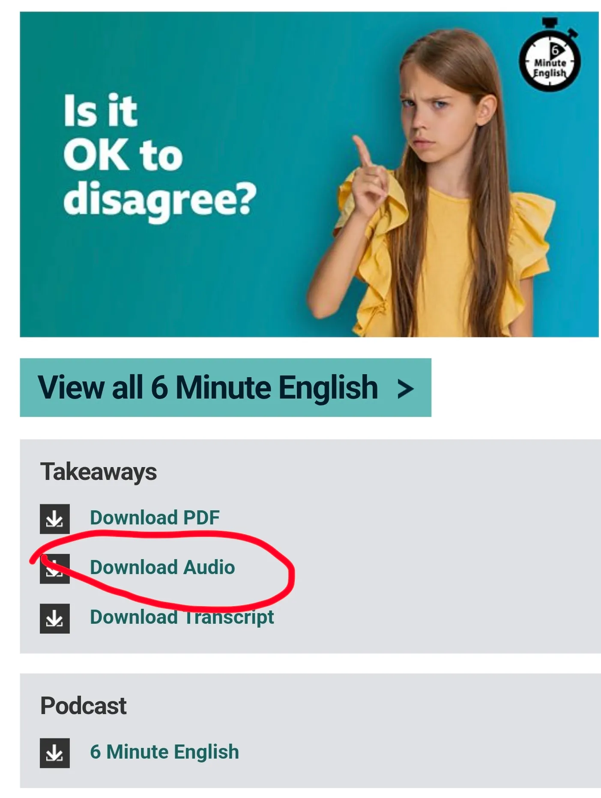
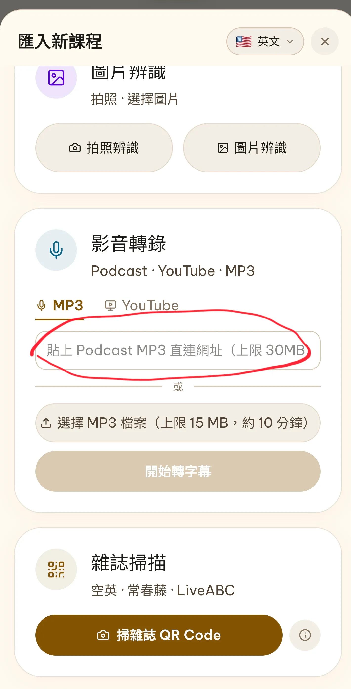
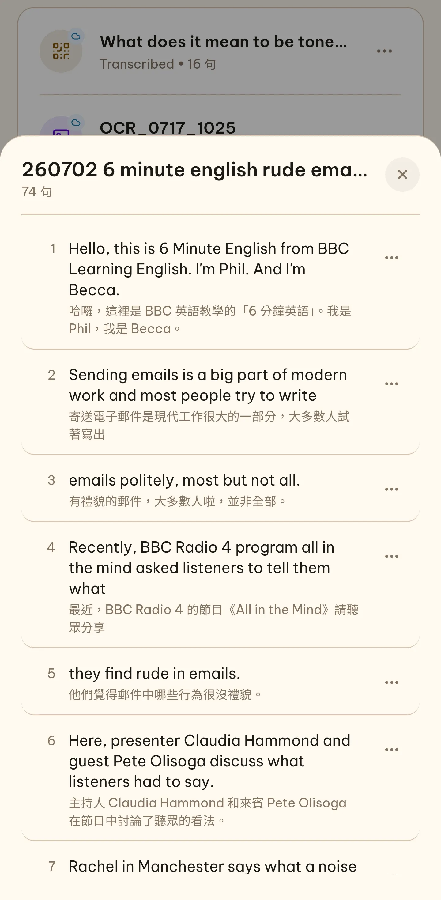

在 Threads 上問「有什麼免費的英文聽力資源」，幾乎每次都會有人推薦 **[BBC Learning English](https://www.bbc.co.uk/learningenglish/english/) 的 6 Minute English（六分鐘英文）**。

推薦的理由很充分：

- **完全免費**，而且每週都有新的一集
- **一集大約六分鐘**，通勤、午休就能聽完
- **主題貼近生活**：工作郵件、人際關係、科技、健康……
- **兩位主持人對話**，是真實語速的英國英文，每集還會帶幾個重點單字

但我發現，很多人收藏了、也聽了幾集，最後還是停在「聽過」，沒有真的練起來。

---

## 六分鐘，其實很難「聽懂」

六分鐘聽起來很短，但對多數人來說，正常語速的六分鐘對話，資訊量是很大的。

常見的情況是：

1. 從頭聽到尾，大概懂在聊什麼，但很多句子只是「飄過去」
2. 想回頭聽某一句，拉進度條拉過頭，或拉不夠
3. 打開官網的逐字稿（Transcript）對照，一邊看 PDF、一邊操作播放器，很快就累了

跟[英文雜誌的困境](/blog/english-magazine-study/)一樣：**內容很好，但音檔和文字是分開的**，要逐句練就得花很多力氣在操作上。

所以我在 SubFit 裡做了一個方法：**把 6 Minute English 的音檔網址貼進去，直接變成一句一句的課程。**

---

## 步驟一：找到這一集的 MP3 網址

到 [BBC Learning English](https://www.bbc.co.uk/learningenglish/english/) 網站，找到 6 Minute English 單元，點進你想練的那一集。往下捲到 **Takeaways** 區塊，會看到三個下載連結：

我們要的是 **Download Audio**，但不是把檔案下載下來，而是**複製它的連結網址**：

- **電腦**：在「Download Audio」上按右鍵 →「複製連結網址」
- **手機**：長按「Download Audio」→「複製連結」

複製到的網址會是 `downloads.bbc.co.uk` 開頭、`.mp3` 結尾的一串，這就是這一集的音檔直連網址。

---

## 步驟二：貼到 SubFit 的「影音轉錄」

打開 SubFit，進到**課程庫 → 匯入新課程**，找到「**影音轉錄**」區塊：

1. 確認上方語言選的是**英文**
2. 在 **MP3** 分頁的輸入框，貼上剛剛複製的網址
3. 按「**開始轉字幕**」

SubFit 會把音檔轉成文字、依語意斷句、翻譯成中文，整理成一句一句的課程。6 Minute English 一集通常只有幾 MB，遠低於 30 MB 的網址上限。

> 影音轉錄需要登入帳號。免費方案也能用，但有每日與每月的次數限制。

---

## 步驟三：一句一句練

轉好之後，就會得到一堂完整的課。以一集談「讓人覺得失禮的電子郵件」的節目為例，整集被切成 **74 句**，每一句都有原文和中文翻譯：

接下來就照 SubFit 的訓練流程走：

- **盲聽**：先不看字幕，聽聽看自己能抓到多少
- **看聽**：文字和聲音對齊，搞懂每一句在說什麼
- **跟讀**：看中文回想英文，揭曉後跟著主持人念
- **開口**：模仿、錄音，並和原音比對
- **確認**：不懂的句型，用 AI 講解拆開來看

用的是**主持人的原聲**，不是機器合成的語音。每一句都能單獨重播，不用再拉進度條。

---

## 怎麼安排練習

我自己的建議是這樣：

1. **一週一集就夠**：6 Minute English 每週更新一集，跟著節奏走，不貪多
2. **前兩天專心精聽**：每天練一部分句子，把每一句都聽懂、念過
3. **最後再整集盲聽一次**：你會發現，第一次只是飄過去的對話，現在每一句都聽得出來

這也是[跟讀](/blog/is-shadowing-effective/)真正有效的前提：**不是聽很多，而是把一段內容練到真的會。**

---

## 不只 BBC：任何 Podcast 都可以

這個方法不限於 6 Minute English。只要能找到 **MP3 直連網址**，像是很多英文 Podcast 的單集音檔，都可以用同樣的方式貼進 SubFit。

如果手上只有文字、沒有音檔，也可以在匯入畫面選「**貼上文字**」，貼一段文章進去，SubFit 會用 AI 語音幫你念出來。

找一集你有興趣的 6 Minute English，今天就試試看吧。

> BBC Learning English 的內容版權屬於 BBC，請只用於個人學習，不要轉載或散布音檔。

延伸閱讀：

- [英文雜誌怎麼念？方法大家都知道，難的是真的做完](/blog/english-magazine-study/)
- [英文跟讀有效嗎？用過的人都說有效，但有個前提](/blog/is-shadowing-effective/)
